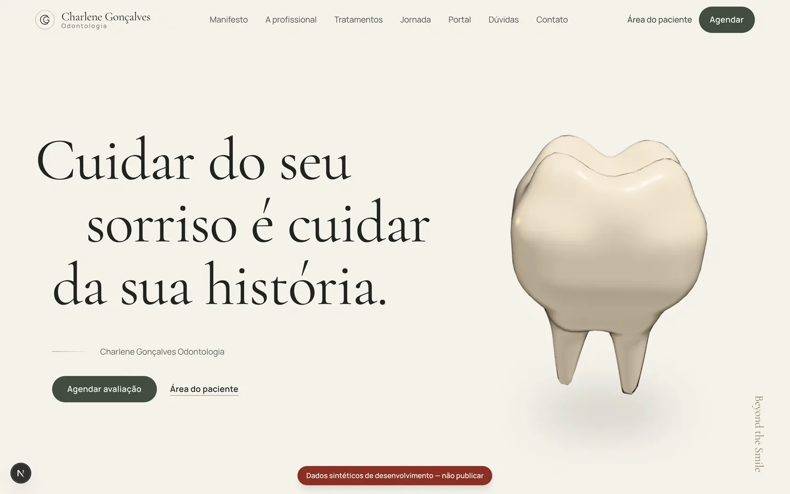
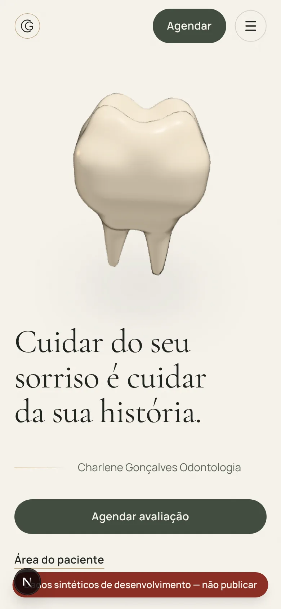
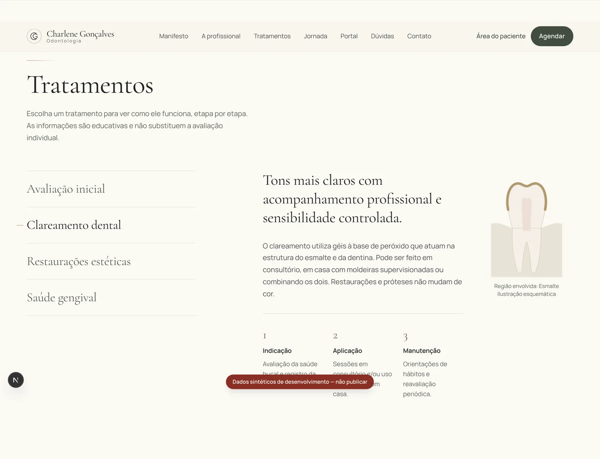
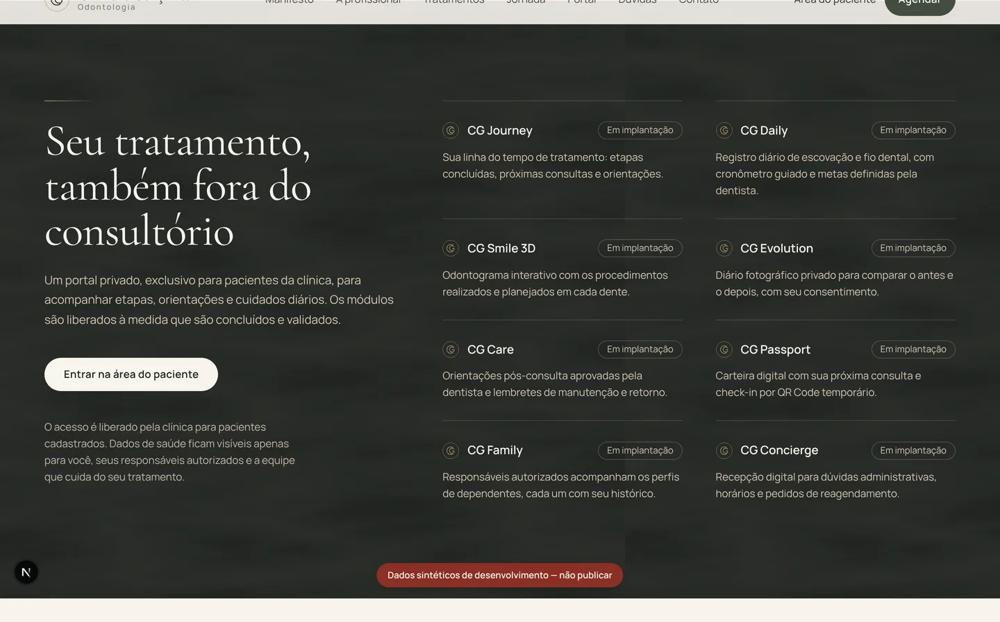

# Charlene Gonçalves Odontologia — Beyond the Smile

Plataforma digital da clínica: site institucional, portal do paciente e (nas próximas fases) o painel CG Studio.

**Estado:** Fases 1 e 3 concluídas (Fase 3 aguardando validação em um projeto Supabase real); Fase 2 com código pronto, aguardando conteúdo oficial. Ver [docs/ROADMAP.md](docs/ROADMAP.md).

## Início rápido

```bash
cp .env.example .env.local      # opcional: preencha o Supabase para ativar pedidos e login
npm install
npm run dev:fixtures            # todas as seções com dados SINTÉTICOS (somente desenvolvimento)
npm run dev                     # conteúdo oficial (seções sem dados ficam pendentes)
```

Requisitos: Node 22.12+. Para `npm run test:db`, binários do PostgreSQL (`initdb`, `pg_ctl`, `psql`).

### Backend local (opcional)

```bash
npx supabase start              # requer Docker; aplica supabase/migrations
# copie a API URL e a chave publishable exibidas para .env.local
```

## Verificação

```bash
npm run verify      # lint + typecheck + testes unitários + testes de banco + build
npm run test:e2e    # Playwright (desktop e mobile) contra o build de produção
npm run content:check
```

## Documentação

- [CLAUDE.md](CLAUDE.md) — regras permanentes do projeto
- [docs/ARCHITECTURE.md](docs/ARCHITECTURE.md) · [docs/DECISIONS.md](docs/DECISIONS.md)
- [docs/SECURITY_LGPD.md](docs/SECURITY_LGPD.md) · [docs/HOSTING_AND_COSTS.md](docs/HOSTING_AND_COSTS.md)
- [docs/CONTENT_VERIFICATION.md](docs/CONTENT_VERIFICATION.md)

## Prévia (dados sintéticos de desenvolvimento)

| Hero (desktop)                                      | Hero (mobile)                                     |
| --------------------------------------------------- | ------------------------------------------------- |
|  |  |



